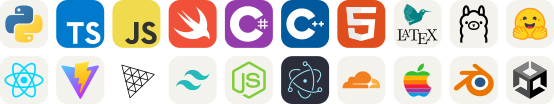

<p align="center">
  <picture>
    <source media="(prefers-color-scheme: dark)" srcset="https://capsule-render.vercel.app/api?type=waving&height=230&color=0:0B1426%2C55:2B5C9A%2C100:9CC8F2&text=Vasiniks&fontColor=ffffff&fontSize=78&fontAlignY=36&desc=GEHIRNS%20%C2%B7%20AI%20research%20%C2%B7%20Frontend%20%C2%B7%20Swift&descSize=20&descAlignY=58&animation=fadeIn" />
    
  </picture>
</p>

<p align="center">
  <picture>
    <source media="(prefers-color-scheme: dark)" srcset="https://readme-typing-svg.demolab.com?font=JetBrains+Mono&weight=600&size=20&duration=2800&pause=900&color=9CC8F2&center=true&vCenter=true&width=640&lines=Sole+member+of+GEHIRNS+%C2%B7+capability+per+GB;magi-1.2-2B+%C2%B7+Qwen3.5-2B+in+1.23+GiB;sprint+%C2%B7+a+coding+agent+for+tiny+local+models;lobotomy+%C2%B7+break+a+small+LLM%2C+live;Frontend+%C2%B7+React+%C2%B7+Three.js+%C2%B7+GSAP;Native+macOS+apps+in+Swift+%26+SwiftUI;Blindfolded+cuber+%C2%B7+Balatro%2C+rebuilt+in+Desmos" />
    
  </picture>
</p>

<p align="center">
  <picture>
    <source media="(prefers-color-scheme: dark)" srcset="https://raw.githubusercontent.com/Vasiniks/Vasiniks/main/assets/stack-dark.svg" />
    
  </picture>
</p>

<p align="center">
  
  
  
  
  
  
  
  
  
</p>

<p align="center">
  <a href="https://gehirns.pages.dev/"></a>
  <a href="https://doi.org/10.5281/zenodo.23630199"></a>
  <a href="https://vasiniks.github.io/Strange-Attractors-Phase-Map-Explorer/"></a>
</p>

<p align="center">I make open models smaller, websites move, and Mac apps stay out of the way.</p>

## 🧪 GEHIRNS, a lab of one

I'm the sole member of **[GEHIRNS](https://github.com/GEHIRNS)**: open models made smaller by measuring where their bits matter, then putting them there. Every model is scored on the same 2,313 tasks and set against the memory it actually takes on one 12 GB GPU.

<a href="https://github.com/GEHIRNS/magi"></a>

- **[magi-1.2-2B](https://huggingface.co/GEHIRNS/magi-1.2-2B)**: Qwen3.5-2B in 1.23 GiB, trained once against repetition loops. sprint runs it by default.
- **[magi-1.1-4B](https://huggingface.co/GEHIRNS/magi-1.1-4B)**: Qwen3.5-4B in 2.61 GiB, with a LoRA that teaches it to finish its thinking.
- **[seele-1.0-3.3B](https://github.com/GEHIRNS/seele)**: a 4B decision model with a quarter of its layers removed and no training: 1.8× less GPU memory at 98% of the score.

```bash
ollama run hf.co/GEHIRNS/magi-1.2-2B
```

**Paper:** [*Where the Bits Go*](https://doi.org/10.5281/zenodo.23630199) (Zenodo, 2026). The recipe and the data behind every table are in [GEHIRNS/magi](https://github.com/GEHIRNS/magi), and a rebuild matches the release byte for byte.

<a href="https://gehirns.pages.dev/"></a>
<a href="https://huggingface.co/GEHIRNS"></a>
<a href="https://doi.org/10.5281/zenodo.23630199"></a>


## 🧠 Small models: one to code with, one to break

<table>
<tr>
<td width="50%" valign="top">
<h3><a href="https://github.com/Vasiniks/sprint">⚡ sprint</a></h3>
<a href="https://sprintai.pages.dev"></a>
<br/><br/>
A terminal coding agent for very small local models (0.5B to 3B, 8K context). It keeps the context small, checks every tool call, stops loops and shows you each action before it runs. Two Python files, no dependencies. On its default model, magi-1.2-2B, it passes 42 of 48 test tasks.
<br/><br/>
<a href="https://sprintai.pages.dev"></a>


</td>
<td width="50%" valign="top">
<h3><a href="https://github.com/Vasiniks/lobotomy">🩻 lobotomy</a></h3>
<a href="https://github.com/Vasiniks/lobotomy"></a>
<br/><br/>
Break a small language model on purpose, live, while you chat with it. Watch each word climb Qwen3.5 0.8B's 24 layers, then switch off, turn down or boost neurons, heads and layers, and ask again. Every edit is a write into the weights in memory, and every edit undoes exactly.
<br/><br/>


</td>
</tr>
</table>

## 🤖 Agents & AI infrastructure

<table>
<tr>
<td width="50%" valign="top">
<h3>🧩 Dovetail <sup>🔒 private beta</sup></h3>
A local-first, multiplayer control plane for coding agents. An orchestrator plans the work, fans it out to Claude Code, OpenCode and Codex in tiled panes, then reviews and merges.
<br/><br/>


</td>
<td width="50%" valign="top">
<h3><a href="https://github.com/Vasiniks/mlaude">🔀 mlaude</a></h3>
One Claude Code session, two providers: a localhost proxy that sends <code>muse-*</code> to Meta and everything else to Anthropic. 1M context, zero dependencies.
<br/><br/>


</td>
</tr>
<tr>
<td width="50%" valign="top">
<h3><a href="https://github.com/Vasiniks/instinct">🃏 instinct</a></h3>
An agent that plays Balatro. Code simulates each move, a small decision model judges, and confidence gates decide who acts. It won 2 of its first 8 games at White stake.
<br/><br/>

</td>
<td width="50%" valign="top">
<h3><a href="https://github.com/Vasiniks/OpenFlow">🌊 OpenFlow</a></h3>
A one-line install that turns a coding agent into a frontend studio: skills, MCP servers, plugins and specialist agents for five agent CLIs.
<br/><br/>


</td>
</tr>
</table>

## 🛠️ Also

- **[Strange Attractors](https://github.com/Vasiniks/Strange-Attractors-Phase-Map-Explorer)**: the largest Lyapunov exponent for every pixel of a parameter plane, on the GPU. <a href="https://vasiniks.github.io/Strange-Attractors-Phase-Map-Explorer/"></a> 
- **[Meridian Hex](https://vasiniks.github.io/Meridian/)**: a product page with the pencil rendered in real-time 3D. <a href="https://vasiniks.github.io/Meridian/"></a> 
- **[Bubble](https://github.com/Vasiniks/bubble)**: a pure-black system monitor that wraps around the MacBook notch. 
- **[icantkeeptrackofmyais](https://github.com/Vasiniks/icantkeeptrackofmyais)**: an edge-docked status light for every AI coding agent on your Mac. 

<sub>Off the clock: blindfolded cubing with my own [3BLD trainer](https://vasiniks.github.io/3bld-trainer/) and [solve analytics](https://vasiniks.github.io/solve-lab-v2/), Balatro rebuilt in Desmos ([BAlrotro](https://github.com/Vasiniks/BAlrotro)), a Unity shadow-puzzle game, and an STM32 synth in C++.</sub>

<p align="center">
  <picture>
    <source media="(prefers-color-scheme: dark)" srcset="https://capsule-render.vercel.app/api?type=waving&height=120&section=footer&color=0:9CC8F2%2C45:2B5C9A%2C100:0B1426" />
    
  </picture>
</p>
